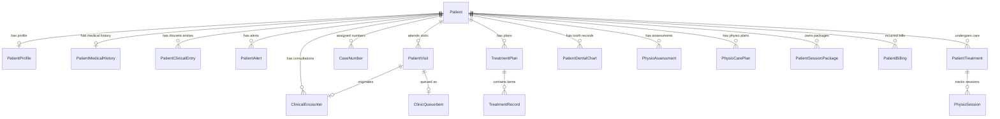

# OralCares — Patient Management Product Rebuild
## Phase 1: Complete Existing System Audit

**Document:** `docs/patient-management/01-existing-system-audit.md`  
**Status:** Audit Complete — Baseline Established  
**Scope:** Frontend screens, backend controllers, services, database tables, validation rules, permissions, tenant isolation, and clinical workflows across the entire Patient Management lifecycle.

---

## 1. Executive Overview & Baseline State

The OralCares clinic portal currently manages patients through an amalgamation of modular layers built across different development phases (Phase 0 Foundation, Phase 2 Appointments/Clinical, Phase 4 Finance, Phase 7 Patient Identity, and recent UI Polish passes).

While individual sub-systems (such as the atomic UHID generator, row-level locking on payments, and tenant scoping via `ClinicScoped`) are robust, the overall **Patient Management ecosystem suffers from conceptual conflation, duplicate data models, fragmented patient navigation, and uncoordinated records**.

### Verified Testing & Code Baseline (At Audit Time)
- **Full Test Suite (`php artisan test --compact`):** 4,115 passed, 15 legacy failed (known test rot in deleted older modules), 9 skipped.
- **Clinic Test Suite (`tests/Feature/Clinic`):** 1,592 passed, 2 skipped, 0 failed.
- **TypeScript Baseline (`npx tsc --noEmit`):** 24 legacy errors (all isolated in `resources/js/ovs/*` and old auth components; **0 errors in Clinic portal code**).
- **Vite Production Build (`npm run build`):** Passing.

---

## 2. Frontend Inventory & Screen-by-Screen Audit

| # | Screen / Component | Primary File(s) | Current Functionality & UX State | Data Rendered & Sources | Redundancies & Architectural Gaps |
| :--- | :--- | :--- | :--- | :--- | :--- |
| **1** | **Patient Directory** | `resources/js/pages/ClinicPortal/Patients/Index.tsx` `.../components/directory/PatientTable.tsx` | Keyset-paginated directory table with search, role-based views (All, Today), filter drawer (branch, doctor, gender, status, treatment status, date ranges). | Name, UHID, phone (masked based on permission), gender, age, assigned doctor, status, registration date. | Lacks clear "Active Case" indication. Balance/financial status cannot be viewed by billing roles directly from the directory without opening Patient 360. |
| **2** | **Patient Create (Registration)** | `resources/js/pages/ClinicPortal/Patients/Create.tsx` `.../components/form/*` | Full permanent patient registration page with duplicate check modal, multi-panel demographics, address, emergency contact, and baseline medical safety. | First/middle/last name, DOB, age, gender, phone, email, blood group, address, emergency contact, allergies, chronic conditions, safety notes. | Creates permanent patient record with UHID, but does NOT initiate an encounter or queue item (separate from intake). |
| **3** | **Patient Edit** | `resources/js/pages/ClinicPortal/Patients/Edit.tsx` | Approved visual reference for Patient Management. Multi-card form updating demographics, address, safety, and assignment. | Same as Patient Create, plus doctor assignment status and death status indicators. | Doctor assignment update is blocked by frontend but requires server-side governance guard. |
| **4** | **New Case (Intake Modal)** | `resources/js/pages/Clinic/Reception/intake/NewCaseForm.tsx` `ReceptionIntakeDialog.tsx` | Fast reception popup: Demographics + Quick Health + Today's Visit (Specialty, Doctor, Reason, Queue Priority, Check-in Fee). | Atomic payload: creates Patient, PatientVisit, CaseNumber, QueueItem, and optional PatientBilling row. | Note field is omitted (no backend save path). Conflates "Case" with a single "Visit/Queue Item". |
| **5** | **Repeat Case (Intake Modal)** | `resources/js/pages/Clinic/Reception/intake/RepeatCaseForm.tsx` `PatientSearchStep.tsx` | Fast returning check-in popup: Phone/UHID/Name search → Select Patient → Select Visit Details → Check-in. | Patient summary card (UHID, Name, Phone, Specialty), Visit reason, Specialty, Doctor, Check-in Fee. | Generates a new `case_numbers` row on every visit, treating Case Number as an annual queue ticket rather than a clinical treatment episode. |
| **6** | **Patient 360 Workspace** | `resources/js/pages/ClinicPortal/Patients/Show.tsx` `.../components/patient360/PatientHeader.tsx` | Master patient record workspace with 17 tab sections, header summary card, quick action buttons, and safety alert banner. | Master patient header, UHID badge, phone/email, assigned doctor, last visit, registration date, section loader. | Overloaded: 17 separate tabs cause cognitive fatigue. Unnecessary duplication between Overview, Visits, Encounters, and Timeline. |
| **7** | **Overview Tab** | `.../components/patient360/Overview.tsx` | Summary dashboard showing stats cards, quick health alert summary, recent visit, upcoming appointments, and active plans. | High-level props aggregated from `Patient360Summary`. | Partially duplicates Visits list and Treatment plans without providing direct actionable clinical workflows. |
| **8** | **Visits & Encounters** | `.../components/patient360/VisitsHistory.tsx` `.../RecordSections.tsx` | Two competing tabs: "Visits" (`patient_visits`) and "Encounters" (`clinical_encounters`). | Visit date, doctor, reason, status, queue state, clinical SOAP narrative, signed status. | Severe duplication: Staff are confused whether to look at "Visits" (reception attendance) or "Encounters" (clinical consultation). |
| **9** | **Clinical Records & History** | `.../RecordSections.tsx` `.../SafetyStrip.tsx` | Displays clinical entries (allergies, conditions, medications) and medical history notes. | Arrays of conditions, allergies, medications, past surgeries, lifestyle habits. | Dual storage: stored both in `patient_medical_histories` (JSON blobs) AND in `patient_clinical_entries` (discrete rows). |
| **10** | **Dental Workspace** | `.../components/patient360/DentalSection.tsx` | Interactive tooth charting panel, tooth status history, periodontal summary, and dental lab orders. | FDI tooth grid (11-48), conditions per tooth, surfaces (MODBL), active treatment plans, lab orders. | Shown even in clinics that do not offer dental services (unless filtered at runtime). Lacks direct integration with procedure billing checkout. |
| **11** | **Physio Workspace** | `.../components/patient360/PhysioSection.tsx` | Physiotherapy assessment summary, care plans, session tracking, and package balance display. | Pain score (VAS), body regions, planned sessions, completed sessions, active package credits. | Front desk has 403 access issues in Combined clinics; lacks visual body pain map in current simplified table view. |
| **12** | **Treatment Plans** | `.../Sections.tsx` (`TreatmentSection`) | List of treatment plans, procedures, estimated costs, acceptance dates, and stage progression. | Plan title, doctor, status (proposed/accepted/completed), itemized procedures, total cost. | Disconnected from daily visit execution; procedure completion is not smoothly linked to encounter checkouts. |
| **13** | **Prescriptions** | `.../Sections.tsx` (`PrescriptionsSection`) | Table of electronic prescriptions issued across consultations with print actions. | Drug name, dosage, frequency, duration, instructions, prescribing doctor, date. | Read-only in Patient 360; creation only happens during consultation. Lacks pharmacy dispense tracking or refill requests. |
| **14** | **Documents & Reports** | `.../Sections.tsx` (`DocumentsSection`) | Uploaded attachments, consent forms, lab reports, and diagnostic imaging. | File name, category, upload date, uploader, file size, download link. | No thumbnail preview for X-rays/radiographs; documents are not organized by clinical episode/case. |
| **15** | **Timeline / Activity** | `.../RecordSections.tsx` (`TimelineSection`) | Chronological feed of recorded system and clinical events. | Timestamp, event title, category, actor, description snippet. | Overloaded with duplicate narrative notes from clinical encounters rather than high-level lifecycle events. |
| **16** | **Patient Billing** | `.../Sections.tsx` (`BillingSection`) | List of patient bills, payment receipts, outstanding balances, and payment button. | Bill number, date, total, paid, balance, status, item breakdown. | Read-only duplicate of central Billing. Uses a secondary dialog instead of the canonical `BillDetailDialog`. |

---

## 3. Backend & Data Architecture Audit

### 3.1 Core Models & Their Current Responsibilities

### 3.2 Evaluation Against the 9 Core Audit Dimensions

#### 1. Abhi kya functionality hai? (Current Functionality)
- **Identity & UHID:** Atomic, sequential, clinic-scoped UHID generation (`OC-00000001`).
- **Registration:** Multi-field patient profile registration with server-side duplicate phone/email detection.
- **Reception Intake:** Fast New Case (registration + check-in + fee) and Repeat Case (lookup + check-in).
- **Clinical Consultations:** Doctor consultation workspace recording SOAP notes, diagnoses, procedures, and prescriptions.
- **Dental Module:** Tooth charting with surface-level conditions and lab order tracking.
- **Physio Module:** Assessment recording, care plans, session tracking, and package balance deduction.
- **Billing Integration:** Check-in fee collection, procedure billing, and payment processing under row locks.

#### 2. Kaunsa data store hota hai? (Data Stored)
- **Demographics:** First, middle, last name, DOB, age, gender, phone, email, blood group, UHID.
- **Profile / Address:** Locality, city, state, postal code, emergency contact, preferred channel, referral source.
- **Medical Safety:** Allergies, chronic illnesses, blood disorders, pregnancy, cardiac issues, habits, active safety alerts.
- **Encounter Records:** Vitals, chief complaint, clinical narrative (history, examination), diagnoses, notes.
- **Treatments & Dental:** Tooth numbers, surfaces, procedures, treatment plans, stages, dental lab orders.
- **Physiotherapy:** Body region, pain severity (VAS 0-10), ROM, muscle strength, exercises, session logs.
- **Financials:** Invoices, items, payments, payment methods, receipts, refunds, adjustments.

#### 3. Kaunse table/model mein store hota hai? (Tables & Models)
- `patients` (`Patient`) & `patient_profiles` (`PatientProfile`)
- `patient_medical_histories` (`PatientMedicalHistory`) & `patient_clinical_entries` (`PatientClinicalEntry`)
- `patient_alerts` (`PatientAlert`)
- `patient_visits` (`PatientVisit`) & `case_numbers` (`CaseNumber`)
- `clinical_encounters` (`ClinicalEncounter`) & `clinical_notes` (`ClinicalNote`)
- `treatment_plans` (`TreatmentPlan`) & `treatment_records` (`TreatmentRecord`)
- `patient_treatments` (`PatientTreatment`)
- `patient_dental_charts` (`PatientDentalChart`), `periodontal_exams`, `endodontic_records`
- `physio_assessments` (`PhysioAssessment`), `physio_care_plans` (`PhysioCarePlan`), `physio_sessions` (`PhysioSession`)
- `patient_session_packages` (`PatientSessionPackage`), `session_package_usages`
- `patient_billings` (`PatientBilling`), `patient_billing_items`, `patient_billing_payments`

#### 4. Kaunse page par dikhaya jata hai? (UI Presentation)
- **Directory:** `Patients/Index.tsx`
- **Patient Registration & Edit:** `Patients/Create.tsx`, `Patients/Edit.tsx`
- **Intake Modals:** `ReceptionIntakeDialog.tsx` (on Front Desk and Appointments Calendar)
- **Patient 360 Workspace:** `Patients/Show.tsx` (across 17 sections)
- **Doctor Consultation Workspace:** `Consultations/Workspace.tsx`
- **Billing Desk:** `Billing/Index.tsx`

#### 5. Kya information duplicate hai? (Data Duplication Analysis)
1. **Case Number vs Visit Number vs Queue Number:**
   `case_numbers` table creates a new record on every visit, treating Case Number as an annual queue ticket (`YYYY-000001`). Meanwhile, `patient_visits` has `id`, `clinical_encounters` has `encounter_number`, and `clinic_queue_items` has `queue_position`. Case Number is currently NOT an episode of care!
2. **Medical History (JSON) vs Clinical Entries (Rows):**
   `patient_medical_histories` stores `allergies`, `medical_conditions`, and `current_medications` as JSON arrays. Simultaneously, `patient_clinical_entries` stores the exact same items as individual rows with status, severity, and recorder stamps.
3. **Visits (`patient_visits`) vs Encounters (`clinical_encounters`):**
   Both models represent patient attendance. `patient_visits` represents reception check-in and queueing; `clinical_encounters` represents the doctor's consultation. Showing both as separate top-level tabs confuses staff.
4. **Address fields:**
   `postal_code` and `pincode` exist simultaneously on `patient_profiles`.
5. **Procedure Catalogues:**
   `clinical_procedures` (canonical) vs `treatment_catalogs` (legacy duplicate with 48 active rows).
6. **Billing Dialogs:**
   Central `BillDetailDialog` vs Patient 360's standalone `BillDialog`.

#### 6. Kya functionality incomplete hai? (Incomplete Features)
- **After-Visit Checkout UI:** When a doctor completes and signs a consultation, the Front Desk and Billing register display "Ready to bill", but clicking it opens a placeholder because `Billing/Checkout.tsx` is unbuilt.
- **Duplicate Patient Merge UI:** Backend service `PatientMergeService` and governance action `patient.merge` exist and pass tests, but there is no user-facing screen or modal to merge duplicate patient records.
- **Thermal Receipt Reprinting:** Per-payment receipt reprint is only accessible immediately upon check-in payment; opening past payments in Patient 360 or Billing only offers A4 invoices.
- **Treatment Charges UI:** Backend routes `patients/{patient}/treatment-charges` exist, but no dedicated UI allows staff to manage standalone treatment charges outside consultations.

#### 7. Kya unnecessary complexity hai? (Unnecessary Complexity)
- **17 Separate Tabs in Patient 360:** Breaking a patient's record into 17 micro-tabs (Timeline, Visits, Encounters, Appointments, Treatment, Prescriptions, Investigations, Billing, Documents, Follow-ups, Communications, Requests, Audit, Dental, Physio, Consents, Overview) creates massive click fatigue and fragmented context.
- **Dual Treatment Models:** `TreatmentPlan` + `TreatmentRecord` (older dental model) runs in parallel with `PatientTreatment` + `PatientTreatmentStage` (enterprise model).
- **Redundant Scopes in Services:** Services repeatedly use `withoutGlobalScopes()->where('clinic_id', ...)` due to historical inconsistencies with Spatie team contexts during route-model binding.

#### 8. Kya important functionality missing hai? (Missing Functionality)
- **True Episode-of-Care (Clinical Case) Management:** No concept of grouping multiple related visits into a single clinical case (e.g., "Orthodontic Treatment Case 2026" or "Post-Stroke Rehabilitation Episode").
- **Multi-Branch Visibility Controls:** Multi-branch clinics cannot easily view which branches a patient has attended without deep querying.
- **Digital Odontogram Graphical Export:** FDI chart exists as interactive DOM tiles but cannot be exported as an annotated visual PDF for referral.
- **Visual Physio Pain & Body Map:** Current physio assessment captures pain scores numerically but lacks an interactive front/back body diagram.

#### 9. Kya security, tenant isolation ya historical-data risk hai? (Security & Integrity Risks)
- **Contact Masking Exposure:** Previously identified gap where phone numbers were masked only in the frontend table component while Inertia page props sent the full raw string to unauthorized roles. (Must remain enforced at the server-side API resource layer).
- **Default Doctor Reassignment Bypass:** Previously, a dropdown in the Patient 360 header allowed staff to change the patient's default practitioner without Owner/Admin approval. (Now blocked in UI, but must be locked server-side).
- **Historical Doctor Attribution Overwrite Risk:** If a patient's assigned doctor changes, past visits and completed consultations must NEVER reflect the new doctor; they must permanently retain the historical practitioner.
- **Destructive Migration Risk:** An untracked migration previously dropped archive columns (`patients.archived_at`). Deletions must only proceed through governed soft-state approvals (`DeletionGovernance`).

---

## 4. Current Baseline Conclusion

The backend core of OralCares has enterprise-grade strengths: row locks, transactional idempotency, and solid database constraints. However, **the product architecture is currently organized around database tables rather than clinical and administrative user journeys.**

A complete product rebuild requires restructuring the data hierarchy into:
$$\text{Patient (UHID)} \longrightarrow \text{Case (Episode of Care)} \longrightarrow \text{Visit / Encounter} \longrightarrow \text{Billing Ledger}$$
while consolidating duplicate models and simplifying Patient 360 into a high-efficiency operational workspace.
