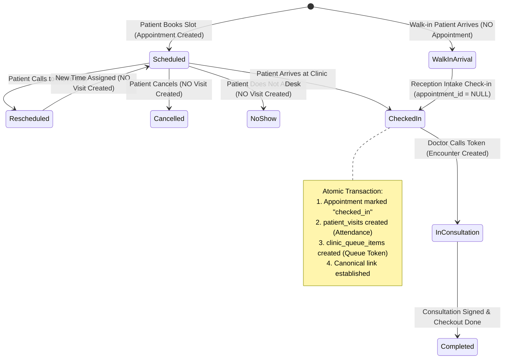
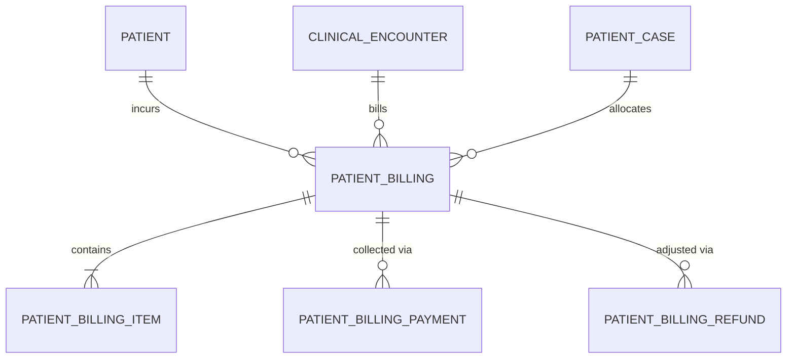
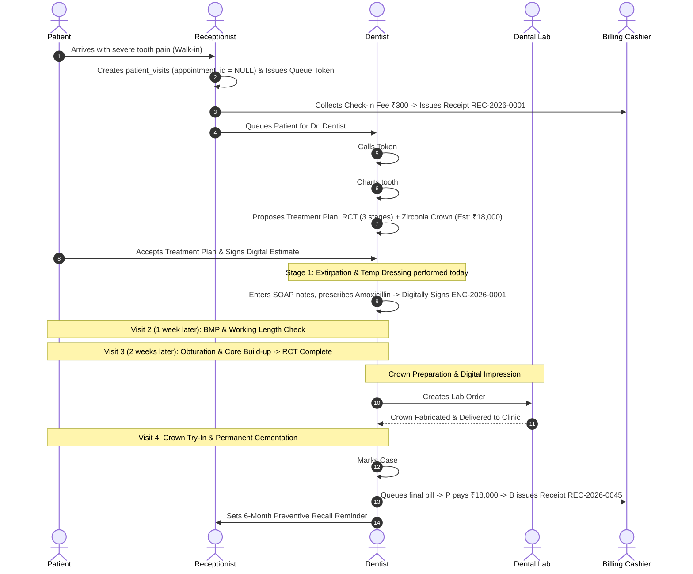
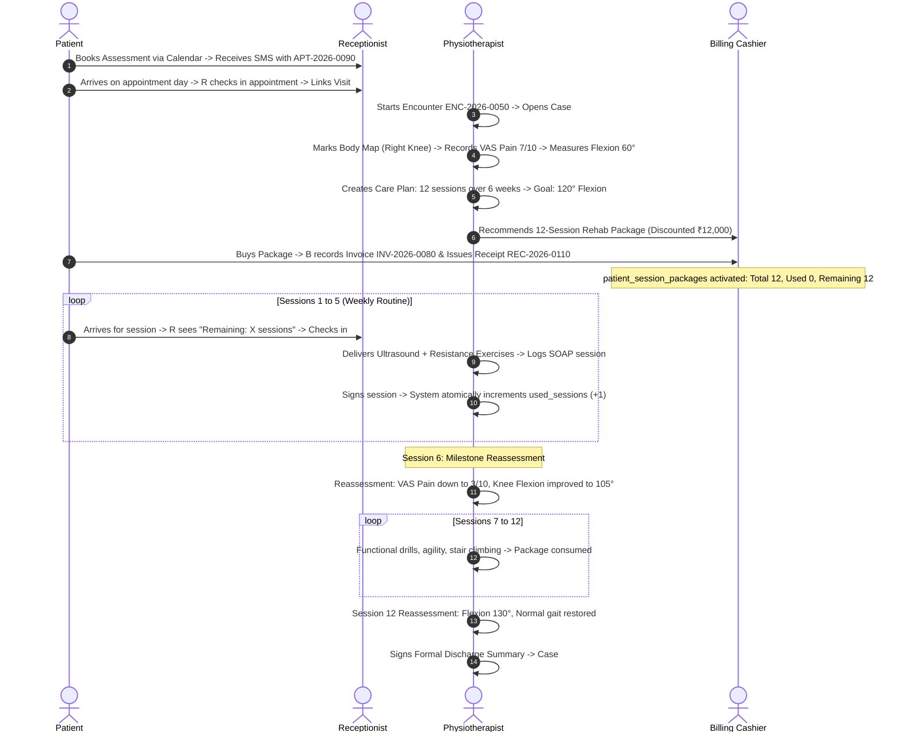

# OralCares — Patient Management Product Rebuild
## Phase 4: Core Entities, Identifiers, Lifecycles & Relationship Architecture

**Document:** `docs/patient-management/04-patient-case-visit-architecture.md`  
**Status:** Approved Architectural Blueprint (Revised & Fully Synchronized)  
**Objective:** Decouple all foundational identifiers, correct appointment-to-visit relationships, formalize attendance ($1 \rightarrow 0..1$) encounters, decouple financial structures, and establish complete operational lifecycles across Dental, Physiotherapy, Appointments, and Multiple Active Cases.

---

## 1. The 6 Independent Identifiers (Eradicating Conflation)

To eliminate the historical defect where "Case Number" was conflated with an annual queue counter, OralCares establishes **6 strictly independent, purpose-built identifiers**:

```
┌──────────────────────────────────────────────────────────────────────────────────────────────────┐
│                                     1. PATIENT UHID                                              │
│               Format: OC-00000001 · Scope: Unique per Clinic across all Branches                 │
│               Lifetime patient health record · Never resets · Single electronic chart            │
└───────────────┬──────────────────────────────────────────────────────────────────┬───────────────┘
                │ 1:N                                                              │ 1:N
                ▼                                                                  ▼
┌──────────────────────────────────────────────┐                  ┌────────────────────────────────┐
│             2. CASE NUMBER                   │                  │       3. APPOINTMENT ID        │
│          (Episode of Care)                   │                  │      (Calendar Reservation)    │
│      Format: CASE-2026-000042                │                  │     Format: APT-2026-001234    │
│      Scope: Unique per Clinic                │                  │     Scope: Unique per Clinic   │
│      Clinical diagnosis/treatment goal       │                  │     Scheduled time, doctor     │
└───────────────┬──────────────────────────────┘                  └────────────────┬───────────────┘
                │ 1:N                                                              │ 0..1 : 0..1
                │                                                                  ▼
                │                                                 ┌────────────────────────────────┐
                │                                                 │        4. QUEUE TOKEN          │
                │                                                 │     (Daily Flow & TV Board)    │
                │                                                 │     Format: #04 (Dr. Sen)      │
                │                                                 │     Scope: Branch per Day      │
                │                                                 │     Ephemeral · Daily reset    │
                │                                                 └────────────────┬───────────────┘
                │                                                                  │
                └───────────────────────────────┬──────────────────────────────────┘
                                                ▼
                               ┌──────────────────────────────────┐
                               │     5. VISIT / ENCOUNTER NUM     │
                               │   Attendance: patient_visits.id  │
                               │   Clinical: ENC-2026-004521      │
                               │   Scope: Unique per Clinic       │
                               │   Relationship: 1 -> 0..1        │
                               └────────────────┬─────────────────┘
                                                │ 1:N
                                                ▼
                               ┌──────────────────────────────────┐
                               │       6. FINANCIAL LEDGER        │
                               │    Invoice: INV-2026-001234      │
                               │    Receipt: REC-2026-003456      │
                               │    Scope: Branch per Fin. Year   │
                               │    Multi-installment ledger      │
                               └──────────────────────────────────┘
```

### Detailed Taxonomy of the 6 Identifiers

| # | Identifier Name | Exact Definition & Lifecycle Scope | Proposed Format | Uniqueness Scope | Storage Anchor | Generation Timing & Reset Rule | Display Location |
| :- | :--- | :--- | :--- | :--- | :--- | :--- | :--- |
| **1** | **Patient UHID** | Permanent lifetime health identity. Never changes. | `OC-00000001` (8 digits) | Unique per **Clinic** across all branches. | `patients.uhid` | Generated on first registration via atomic lock. **Never resets.** | Patient header, wristbands, prescriptions, invoice headers. |
| **2** | **Case Number** | Clinical episode of care (e.g. "Root Canal #36", "Knee Rehab"). | `CASE-YYYY-000001` | Unique per **Clinic** per calendar year. | `patient_cases.case_number` | Generated when a diagnosis/treatment plan is opened. Active until closed. | Cases tab, treatment plan estimates, lab orders. |
| **3** | **Appointment ID** | Calendar time reservation. Can be cancelled or rescheduled. | `APT-YYYY-000001` | Unique per **Clinic** per calendar year. | `appointments.id` / `booking_reference` | Generated when a calendar slot is booked. Does not imply attendance. | Calendar cards, WhatsApp reminders, booking dialogs. |
| **4** | **Queue Token** | Daily operational calling token for clinic reception and TV displays. | `#01`, `#02`, `#03` (per doctor) | Unique per **Branch** per Doctor per **Day**. | `clinic_queue_items.queue_position` | Issued upon reception check-in. **Resets daily at midnight.** | Reception queue board, waiting area TV, calling audio. |
| **5** | **Encounter Number** | Official clinical consultation document containing signed SOAP notes. | `ENC-YYYY-000001` | Unique per **Clinic** per calendar year. | `clinical_encounters.encounter_number` | Generated when clinician starts consultation. Signed and sealed. | Consultation summary, prescriptions, clinical addenda. |
| **6a**| **Invoice Number** | Commercial legal receivable document detailing invoiced services. | `INV-YYYY-000001` | Unique per **Branch** per Financial Year. | `patient_billings.bill_number` | Generated when charges are billed. | Formal A4 invoices, accounting ledger, tax reports. |
| **6b**| **Receipt Number** | Proof of payment transaction against an invoice or package purchase. | `REC-YYYY-000001` | Unique per **Branch** per Financial Year. | `patient_billing_payments.receipt_number` | Generated on **each successful payment event**. | Thermal receipts, payment SMS/WhatsApp confirmations. |

---

## 2. Appointment vs Visit Relationship Architecture

An **Appointment** is a *scheduled temporal intention*, whereas a **Visit** is a *physical or tele-attendance event*.



### Canonical Relationship & Integrity Constraints
1. **Canonical Foreign Key:** `patient_visits.appointment_id` is the single canonical database foreign key linking a visit to its scheduled appointment, enforcing **`ON DELETE RESTRICT`** to preserve booking provenance.
2. **Cardinality:** `Appointment (0..1) <---> (0..1) PatientVisit`
   - Enforced by a unique constraint:
     ```sql
     UNIQUE KEY `patient_visits_appointment_unique` (`appointment_id`)
     ```
   - This database constraint guarantees that **one appointment can NEVER generate multiple visits**.
3. **Removal of Redundant Backlink:** `appointments.patient_visit_id` is **REMOVED** from the target schema. An appointment's attended visit is derived cleanly via the canonical relationship (`hasOne(PatientVisit::class, 'appointment_id')`), eliminating split-brain desynchronization risks.
4. **Walk-ins:** For an unscheduled patient, `patient_visits.appointment_id = NULL`. Zero dummy appointments are created.
5. **Cancellations & No-Shows:** When an appointment is cancelled or missed, `appointments.status` updates to `cancelled` or `no_show`. **No `patient_visits` row is ever created.**
6. **Rescheduling:** Rescheduling updates `appointments.scheduled_at`. No visits are created or altered.
7. **Multi-Tenant Scoping Rule:** Application services assert that both the appointment and the visit belong to the exact same `clinic_id` and `branch_id`. Cross-clinic or cross-branch linking throws a validation exception.

---

## 3. Attendance Record (`patient_visits`) vs Signed Clinical Encounter (`clinical_encounters`)

### Cardinality: `PatientVisit 1 → 0..1 ClinicalEncounter`

A patient visit does NOT automatically guarantee a clinical consultation. A patient may check in and leave without being seen, cancel due to long wait times, or attend solely for an administrative/billing matter.

```
┌─────────────────────────────────────────────────┐   ┌─────────────────────────────────────────────────┐
│        ATTENDANCE RECORD (patient_visits)       │   │   SIGNED CLINICAL ENCOUNTER (clinical_encounters)│
├─────────────────────────────────────────────────┤   ├─────────────────────────────────────────────────┤
│ • Cardinality: Parent Record (Always created)   │   │ • Cardinality: Optional Child (0..1)            │
│ • Created by: Receptionist / Triage Nurse       │   │ • Created by: Treating Clinician                │
│ • When: Moment patient checks in at front desk  │   │ • When: Moment doctor starts consultation       │
│ • Scope: Operational presence at branch today   │   │ • Scope: Legal medical consultation & diagnoses │
│ • Content: Check-in time, triage vitals (BP),   │   │ • Content: Subjective history, examination,     │
│   visit reason, queue token, intake fee status  │   │   SOAP narrative, tooth/body findings, Rx       │
│ • Mutability: Modifiable by reception staff     │   │ • Mutability: Legally sealed on digital signing │
│ • Lifecycle: registered -> waiting -> completed │   │ • Lifecycle: draft -> in_progress -> finalized  │
│   OR left_without_being_seen / cancelled        │   │   OR voided (entered-in-error)                  │
└─────────────────────────────────────────────────┘   └─────────────────────────────────────────────────┘
```

### Operational Scenarios:
1. **Normal Flow (1 Visit $\rightarrow$ 1 Encounter):** Patient checks in $\rightarrow$ `patient_visits` created. Doctor calls patient $\rightarrow$ `clinical_encounters` created. Doctor signs notes $\rightarrow$ Encounter finalized.
2. **Left Without Being Seen (1 Visit $\rightarrow$ 0 Encounter):** Patient checks in $\rightarrow$ `patient_visits` created (`waiting`). Patient leaves due to emergency $\rightarrow$ Visit status updated to `left_without_being_seen`. **Zero `clinical_encounters` row is ever created.**
3. **Billing/Intake Only (1 Visit $\rightarrow$ 0 Encounter):** Patient attends only to clear an outstanding invoice or collect a physical certificate $\rightarrow$ `patient_visits` created $\rightarrow$ No consultation occurs $\rightarrow$ Zero encounter.

### The Legal Immutability & Addendum Rule
- Once a clinician signs an encounter (`clinical_encounters.finalized_at IS NOT NULL`), the encounter record is **cryptographically sealed** using a SHA-256 hash.
- **No user—including the Clinic Owner/Admin—can edit the signed narrative.**
- Any medical clarification, dosage change, or late entry must be appended as a timestamped `ClinicalEncounterAddendum`:
  $$\text{Encounter (Immutable)} + \sum \text{Addenda (Timestamped, Attributed, Reason-Logged)}$$

---

## 4. Financial Ledger Integrity: Invoices, Items, Payments & Receipts

### 4.1 Exact Calculation Formulas
To prevent double subtraction of discounts, the financial engine enforces the exact formula:

$$\mathbf{total\_amount} = \mathbf{subtotal} - \mathbf{discount\_amount} + \mathbf{tax\_amount}$$

$$\mathbf{balance\_amount} = \mathbf{total\_amount} - \mathbf{successful\_paid\_amount}$$

Where:
- `subtotal`: Gross sum of all line item prices ($\sum \text{quantity} \times \text{unit\_price}$).
- `discount_amount`: Total approved invoice-level and item-level discounts.
- `tax_amount`: Configurable tax liability (computed per clinic tax settings; NOT hardcoded to GST).
- `successful_paid_amount`: Sum of payments with `status = 'successful'`. Failed or pending payments are strictly excluded.
- `balance_amount`: Net outstanding receivable balance from the patient.



### 4.2 Financial Lifecycle & Edge Case Rules
1. **Partial Payments & Installments:** An invoice can receive multiple payments over time. Each successful payment reduces `balance_amount` and generates its own independent receipt number (`REC-YYYY-000001`).
2. **Failed Payment Attempts:** If a card or UPI payment fails, the transaction is logged as `failed`. **It does NOT increment `paid_amount` and does NOT decrement `balance_amount`. Zero receipt is generated.**
3. **Refunds & Reversals:**
   - Refunds require Owner Mode governance.
   - A refund is recorded in `patient_billing_refunds`.
   - A refund reduces `net_collected` or increases `balance_amount`. It can NEVER cause `balance_amount` to become negative.
4. **Invoice Voiding (Entered in Error):**
   - Invoices cannot be physically deleted.
   - An unpaid invoice can be marked `status = 'voided'` with `voided_at`, `voided_by`, and `void_reason`.
   - If payments were already collected, a formal refund/reversal must be processed before or concurrent with voiding.
5. **Prepaid Therapy Packages (Physiotherapy):**
   - The package purchase is invoiced via `patient_billings` with an item of type `therapy_package`.
   - **Session credits in `patient_session_packages` are activated ONLY when the invoice is marked `paid` or an approved credit terms agreement is logged.**
   - Each completed session punches and consumes exactly 1 session credit.
6. **Treatment Charges Spanning Multiple Visits (Dental):**
   - A multi-visit root canal or aligner case can have a single overarching treatment plan estimate.
   - Invoicing can occur:
     - *Upfront:* Full case billed on Day 1, paid in milestones.
     - *Per-Visit:* Each visit bills only the procedure performed on that date (e.g. Visit 1: ₹5,000 for Extirpation; Visit 3: ₹8,000 for Obturation).

---

## 5. Clinician Signing Authority vs Owner/Admin Governance

| Domain / Operational Realm | Treating Clinician Authority | Owner / Admin Governance Role |
| :--- | :--- | :--- |
| **Clinic Operations & Staffing** | Follows clinic shift schedule and branch placements. | **Full Executive Authority.** Manages staff, roles, branches, schedules, and clinic settings. |
| **Clinical Diagnosis & Opinions** | **Sole Medical Authority.** Only the examining clinician diagnoses and plans medical care. | **Zero Medical Override.** Owner cannot alter a clinician's medical diagnosis or clinical notes. |
| **Signing & Finalizing Consultations** | **Sole Signer.** Clinician digitally seals the consultation with their private signature hash. | **Audit Verification.** Owner reviews compliance and signature audit trails. |
| **Voiding a Record Entered in Error** | **Request Only.** Clinician flags the record as "Entered in Error" with a mandatory rationale. | **Approval Gate.** Only Owner Mode can approve a record void. The record is soft-voided, never erased. |
| **Post-Finalization Amendments** | Clinician authors timestamped addenda to their own past records. | Owner monitors addendum frequency in compliance audits. |
| **Billing Discounts & Fee Waivers** | Clinicians may recommend a fee discount. | **Approval Required.** Discounts exceeding threshold require Owner/Admin approval. |
| **Payment Refunds & Write-Offs** | Zero financial refund authority. | **Sole Financial Authority.** Only Owner Mode can process financial refunds or write off bad debt. |

---

## 6. Doctor Reassignment vs Historical Clinical Authorship

A critical medico-legal safeguard in OralCares: **Changing a patient's default doctor must NEVER rewrite history.**

```
                                 DOCTOR REASSIGNMENT TIMELINE
  
  May 2025: Dr. John assigned as default doctor
  ┌────────────────────────────────────────────────────────────────────────┐
  │ 15-May-2025: Visit #1 attended -> Dr. John conducts RCT Consultation   │
  │ ENC-2025-001234 Finalized & Signed by: Dr. John (Employee #104)        │
  └────────────────────────────────────────────────────────────────────────┘
  
  January 2026: Dr. John leaves clinic. Owner reassigns patient to Dr. Sarah
  ┌────────────────────────────────────────────────────────────────────────┐
  │ patients.current_practitioner_id updated to Dr. Sarah (Employee #108)  │
  │ Governed by: SecurityAuditLog event 'patient.practitioner_reassigned'  │
  └────────────────────────────────────────────────────────────────────────┘
  
  March 2026: Historical Chart Inspection
  ┌────────────────────────────────────────────────────────────────────────┐
  │ • Patient Header shows: Default Doctor: Dr. Sarah                      │
  │ • 15-May-2025 Encounter record STILL shows: Treating Doctor: Dr. John  │
  │ • Medico-legal authorship is 100% preserved. Zero historical overwrite.│
  └────────────────────────────────────────────────────────────────────────┘
```

---

## 7. Patient Deletion Protection & Deletion Governance

### Absolute Protection Against Silent Cascading Deletion
Healthcare SaaS regulations forbid hard-deleting clinical and financial records. Therefore:
1. **`ON DELETE RESTRICT` Enforced:**
   - `patient_billings.patient_id` $\rightarrow$ `ON DELETE RESTRICT`. A patient with existing invoices cannot be deleted.
   - `patient_billing_payments.billing_id` $\rightarrow$ `ON DELETE RESTRICT`. Invoices with payment records cannot be deleted.
   - `clinical_encounters.patient_id` $\rightarrow$ `ON DELETE RESTRICT`. A patient with clinical consultations cannot be deleted.
   - `patient_visits.patient_id` $\rightarrow$ `ON DELETE RESTRICT`. A patient with attendance history cannot be deleted.
2. **Governed Archival & Soft Deletion:**
   - Any patient deletion request must pass through `DeletionGovernance`.
   - The record status transitions to `inactive` or `archived`.
   - In the event of patient demise, the governed action `RecordDeath` sets `date_of_death` and status to `deceased`. All past records remain permanently viewable in read-only audit mode.
3. **Duplicate Record Merge (`patient.merge`):**
   - Merging patient A into patient B re-points cases, visits, encounters, and invoices to patient B.
   - Patient A is flagged `status = 'merged'`, `merged_into_patient_id = B.id`.
   - Patient A's historical record remains queryable for forensic traceability, but is locked against new check-ins or appointments.

---

## 8. Multi-Branch Security & Patient Access Architecture

```
                             CLINIC: APEX DENTAL & PHYSIO (TENANT 42)
  
                    ┌────────────────────────────────────────────────────────┐
                    │                                                        │
                    ▼                                                        ▼
           BRANCH A: DOWNTOWN                                       BRANCH B: SUBURB
  
  STAFF MEMBERSHIP:                                        STAFF MEMBERSHIP:
  • Receptionist Priya (Downtown placement only)           • Receptionist Amit (Suburb placement only)
  • Dr. Sen (Downtown placement only)                      • Dr. Priya (Suburb placement only)
  
  QUEUE ISOLATION:                                         QUEUE ISOLATION:
  • Downtown Queue Board displays ONLY Downtown patients   • Suburb Queue Board displays ONLY Suburb patients
  • Priya CANNOT view or manage Suburb queue               • Amit CANNOT view or manage Downtown queue
  
  CROSS-BRANCH PATIENT CHART ACCESS (Patient Ananya registered at Downtown):
  1. Ananya books appointment or arrives as walk-in at Suburb Branch.
  2. Dr. Priya at Suburb examines Ananya (active attendance visit context).
  3. System permits Dr. Priya to view:
     • Master Safety Profile: Allergies (Penicillin) & Chronic Conditions (Global Tier 1)
     • Historical Dental Odontogram (Teeth treated at Downtown)
  4. Detailed Private Clinical Notes from Downtown:
     • Governed by OPD-03 (Owner-Approved: 2026-10-30).
     • Accessible ONLY in the context of an active attendance at Suburb Branch.
     • Requires explicit permission `clinical.notes.cross_branch`.
     • System automatically writes forensic audit log to `patient_clinical_access_audits`:
       [actor: Dr. Priya, patient: Ananya, source_branch: Downtown, accessing_branch: Suburb, 
        resource: ENC-2025-001234, context: active_attendance, timestamp: 2026-03-15 10:30:00]
  5. Financial Ledger & Visibility Scoping:
     • Governed by OPD-01 (Owner-Approved: 2026-10-30).
     • Dr. Priya can view ONLY her own procedure fees and agreed estimates (`billing.view_own_fees`).
     • Clinic-wide collections, turnover, and practice ledger require `billing.view_all`.
     • Invoices raised by Dr. Priya belong to Suburb Branch (tax & revenue attribution).
     • Cash collected at Suburb is banked in Suburb Cash Drawer.
```

---

## 9. Comprehensive Lifecycle Diagrams & Concrete Examples

### 9.1 Dental Multi-Stage Treatment Lifecycle
*Scenario: Patient walks in with acute tooth pain on tooth #36.*



---

### 9.2 Physiotherapy Rehabilitation Lifecycle
*Scenario: Patient referred for post-surgical ACL rehabilitation (12 sessions planned).*



---

### 9.3 Walk-in vs Booked Appointment Flow Comparison

```
                         WALK-IN FLOW                                          BOOKED APPOINTMENT FLOW
  
  1. Patient walks into clinic with no booking.         1. Patient books via phone/online 5 days prior.
     [No Appointment Entity Exists]                        [Appointment APT-2026-0042 Created: Status 'booked']
  
  2. Receptionist searches / registers patient.         2. Appointment Reminder sent automatically via WhatsApp.
  
  3. Receptionist opens New/Repeat Case dialog.         3. Patient arrives on scheduled date.
     • Visit Reason: "Acute Bleeding Gum"                  Receptionist opens calendar / intake:
     • Doctor: Dr. Sharma                                  • Selects appointment APT-2026-0042
     • Fee: ₹400 collected -> REC-2026-0012                • Clicks [Check In]
  
  4. System Creates in ONE atomic transaction:          4. System Updates & Creates in ONE atomic transaction:
     • patient_visits (appointment_id = NULL)              • appointments.status = 'checked_in'
     • clinic_queue_items (Token #04)                      • appointments.patient_visit_id = visit.id
                                                           • patient_visits (appointment_id = APT-2026-0042)
                                                           • clinic_queue_items (Token #05)
  
  5. Patient waits in room -> Token #04 called.         5. Patient waits in room -> Token #05 called.
```

---

### 9.4 Multiple Concurrent Active Cases Lifecycle
*Scenario: Patient "Vikram Malhotra" undergoes simultaneous Dental Orthodontics and Physio Cervical Spondylosis treatment.*

```
                             PATIENT: VIKRAM MALHOTRA (UHID: OC-00000891)
                                      MASTER FINANCIAL LEDGER: ₹45,000 Total
  
                    ┌─────────────────────────────────────────────────────────┐
                    │                                                         │
                    ▼                                                         ▼
       CASE 1: DENTAL ORTHODONTICS                               CASE 2: PHYSIO CERVICAL REHAB
       • Case ID: CASE-2026-000015                               • Case ID: CASE-2026-000032
       • Lead Doctor: Dr. Sen (Orthodontist)                     • Lead Doctor: Dr. Priya (Physiotherapist)
       • Specialty: Dental                                       • Specialty: Physiotherapy
       • Objective: Clear Aligner Therapy (18 Months)            • Objective: Postural Neck Pain Relief (4 Weeks)
       • Treatment Plan: Aligners 1 to 24 (₹60,000)              • Treatment Plan: 10 Sessions Cervical Mobilization
       • Status: ACTIVE                                          • Status: ACTIVE
  
       CLINICAL WORKSPACE RENDERING:                             CLINICAL WORKSPACE RENDERING:
       • Loads FDI Tooth Chart (11 to 48)                        • Loads Body Map (Cervical Spine C4-C7)
       • Overjet / Overbite measurements                         • Cervical ROM Table (Flexion, Rotation)
       • Dental Lab Aligner Shipment Batches                     • TENS / Traction Modality Records
  
       ATTENDANCE ON 15-OCT-2026:                                ATTENDANCE ON 18-OCT-2026:
       • Visit #881: Dr. Sen delivers Aligner Tray 4             • Visit #895: Dr. Priya delivers Session 3
       • Linked to Case 1                                        • Linked to Case 2
```
