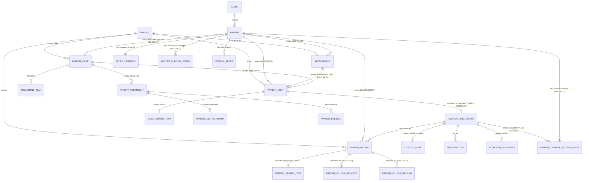

# OralCares — Patient Management Product Rebuild
## Phase 8: Proposed Database & Schema Architecture

**Document:** `docs/patient-management/08-proposed-database-architecture.md`  
**Status:** Approved Schema Architecture (P0/P1 Integrity Corrected)  
**Scale Target:** 100,000+ Multi-Tenant Healthcare Clinics  
**Core Principles:**  
1. Deletion Protection (`ON DELETE RESTRICT`) on all clinical and accounting records.  
2. Strict canonical single-direction foreign key for appointments (`patient_visits.appointment_id`).  
3. Decoupled payment attempts from confirmed legal receipts (`receipt_number` strictly generated on successful payment).  
4. Exact financial calculation avoiding double discounts and double tax calculation.

---

## 1. Unified Entity-Relationship Architecture (Target State)



---

## 2. Table Specifications & Schema Definitions

### 2.1 Master Identity: `patients` (Core Entity with Deletion Protection)
The root record anchoring lifetime identity within a clinic.

```sql
CREATE TABLE `patients` (
  `id` BIGINT UNSIGNED NOT NULL AUTO_INCREMENT PRIMARY KEY,
  `clinic_id` BIGINT UNSIGNED NOT NULL,
  `organization_id` BIGINT UNSIGNED NULL,
  `primary_branch_id` BIGINT UNSIGNED NULL,
  `uhid` VARCHAR(32) NOT NULL,
  `first_name` VARCHAR(100) NOT NULL,
  `middle_name` VARCHAR(100) NULL,
  `last_name` VARCHAR(100) NOT NULL,
  `name` VARCHAR(255) NOT NULL, -- Maintained full name for fast prefix search
  `date_of_birth` DATE NULL,
  `age` SMALLINT UNSIGNED NULL,
  `gender` ENUM('male', 'female', 'other') NOT NULL,
  `phone` VARCHAR(20) NOT NULL,
  `email` VARCHAR(150) NULL,
  `blood_group` ENUM('A+', 'A-', 'B+', 'B-', 'AB+', 'AB-', 'O+', 'O-', 'unknown') DEFAULT 'unknown',
  `current_practitioner_id` BIGINT UNSIGNED NULL, -- Default assigned doctor (Governed by Owner Mode)
  `status` ENUM('active', 'inactive', 'deceased', 'merged') NOT NULL DEFAULT 'active',
  `date_of_death` DATE NULL,
  `death_recorded_at` DATETIME NULL,
  `death_recorded_by` BIGINT UNSIGNED NULL,
  `merged_into_patient_id` BIGINT UNSIGNED NULL,
  `created_at` TIMESTAMP NULL DEFAULT CURRENT_TIMESTAMP,
  `updated_at` TIMESTAMP NULL DEFAULT CURRENT_TIMESTAMP ON UPDATE CURRENT_TIMESTAMP,
  
  -- Constraints & Multi-Tenant Compound Indexes
  UNIQUE KEY `patients_clinic_uhid_unique` (`clinic_id`, `uhid`),
  INDEX `patients_clinic_phone_idx` (`clinic_id`, `phone`),
  INDEX `patients_clinic_status_name_idx` (`clinic_id`, `status`, `name`(20)),
  INDEX `patients_clinic_created_idx` (`clinic_id`, `created_at`),
  INDEX `patients_current_practitioner_idx` (`current_practitioner_id`),
  CONSTRAINT `fk_patients_clinic` FOREIGN KEY (`clinic_id`) REFERENCES `clinics` (`id`) ON DELETE RESTRICT
) ENGINE=InnoDB DEFAULT CHARSET=utf8mb4 COLLATE=utf8mb4_unicode_ci;
```

---

### 2.2 Extended Demographics: `patient_profiles` (1:1 Dependent Profile)

> **Architectural Note on Cascade:**  
> `patient_profiles` is an exact 1:1 dependent demographic extension of `patients` (address, emergency contact, occupation). `ON DELETE CASCADE` is permitted **only** here because `patients` itself is guarded by `ON DELETE RESTRICT` on all clinical and financial child tables. A patient record can NEVER be deleted if visits, encounters, or invoices exist. If an empty draft patient with 0 clinical/financial history is deleted, its dependent profile cleans up automatically.

```sql
CREATE TABLE `patient_profiles` (
  `id` BIGINT UNSIGNED NOT NULL AUTO_INCREMENT PRIMARY KEY,
  `clinic_id` BIGINT UNSIGNED NOT NULL,
  `organization_id` BIGINT UNSIGNED NULL,
  `patient_id` BIGINT UNSIGNED NOT NULL,
  `address` TEXT NULL,
  `locality` VARCHAR(150) NULL,
  `city` VARCHAR(100) NULL,
  `state` VARCHAR(100) NULL,
  `country` VARCHAR(100) DEFAULT 'India',
  `postal_code` VARCHAR(20) NULL, -- Canonical column; replaces legacy pincode
  `occupation` VARCHAR(100) NULL,
  `nationality` VARCHAR(100) DEFAULT 'Indian',
  `emergency_contact_name` VARCHAR(100) NULL,
  `emergency_contact_phone` VARCHAR(20) NULL,
  `referral_source` VARCHAR(100) NULL,
  `created_at` TIMESTAMP NULL DEFAULT CURRENT_TIMESTAMP,
  `updated_at` TIMESTAMP NULL DEFAULT CURRENT_TIMESTAMP ON UPDATE CURRENT_TIMESTAMP,
  
  UNIQUE KEY `patient_profiles_patient_unique` (`patient_id`),
  INDEX `patient_profiles_clinic_idx` (`clinic_id`),
  CONSTRAINT `fk_patient_profiles_clinic` FOREIGN KEY (`clinic_id`) REFERENCES `clinics` (`id`) ON DELETE RESTRICT,
  CONSTRAINT `fk_patient_profiles_patient` FOREIGN KEY (`patient_id`) REFERENCES `patients` (`id`) ON DELETE CASCADE
) ENGINE=InnoDB DEFAULT CHARSET=utf8mb4 COLLATE=utf8mb4_unicode_ci;
```

---

### 2.3 Episodes of Care: `patient_cases` (Canonical Entity with Deletion Protection)

```sql
CREATE TABLE `patient_cases` (
  `id` BIGINT UNSIGNED NOT NULL AUTO_INCREMENT PRIMARY KEY,
  `clinic_id` BIGINT UNSIGNED NOT NULL,
  `branch_id` BIGINT UNSIGNED NOT NULL,
  `patient_id` BIGINT UNSIGNED NOT NULL,
  `case_number` VARCHAR(32) NOT NULL, -- e.g. CASE-2026-000042
  `specialty` ENUM('dental', 'physiotherapy', 'maxillofacial', 'multispecialty') NOT NULL,
  `title` VARCHAR(150) NOT NULL, -- e.g. "Root Canal Therapy #36 & #37", "Post-Op Knee Rehab"
  `chief_complaint` TEXT NOT NULL,
  `primary_diagnosis` VARCHAR(255) NULL,
  `lead_practitioner_id` BIGINT UNSIGNED NOT NULL, -- Belongs to clinic_employees.id
  `referring_doctor` VARCHAR(150) NULL,
  `status` ENUM('active', 'on_hold', 'completed', 'abandoned', 'transferred') NOT NULL DEFAULT 'active',
  `opened_at` DATETIME NOT NULL,
  `closed_at` DATETIME NULL,
  `discharge_summary` TEXT NULL,
  `created_at` TIMESTAMP NULL DEFAULT CURRENT_TIMESTAMP,
  `updated_at` TIMESTAMP NULL DEFAULT CURRENT_TIMESTAMP ON UPDATE CURRENT_TIMESTAMP,
  
  UNIQUE KEY `patient_cases_clinic_number_unique` (`clinic_id`, `case_number`),
  INDEX `patient_cases_patient_status_idx` (`patient_id`, `status`),
  INDEX `patient_cases_branch_status_idx` (`branch_id`, `status`),
  INDEX `patient_cases_lead_practitioner_idx` (`lead_practitioner_id`),
  CONSTRAINT `fk_patient_cases_clinic` FOREIGN KEY (`clinic_id`) REFERENCES `clinics` (`id`) ON DELETE RESTRICT,
  CONSTRAINT `fk_patient_cases_patient` FOREIGN KEY (`patient_id`) REFERENCES `patients` (`id`) ON DELETE RESTRICT
) ENGINE=InnoDB DEFAULT CHARSET=utf8mb4 COLLATE=utf8mb4_unicode_ci;
```

---

### 2.4 Appointments: `appointments` (Temporal Booking — Zero Redundant Backlink)
Represents a scheduled future slot on a practitioner's calendar.  
*Architectural Decision:* The redundant `appointments.patient_visit_id` column is **REMOVED**. The relationship is canonically derived via `patient_visits.appointment_id`.

```sql
CREATE TABLE `appointments` (
  `id` BIGINT UNSIGNED NOT NULL AUTO_INCREMENT PRIMARY KEY,
  `clinic_id` BIGINT UNSIGNED NOT NULL,
  `branch_id` BIGINT UNSIGNED NOT NULL,
  `patient_id` BIGINT UNSIGNED NOT NULL,
  `practitioner_id` BIGINT UNSIGNED NOT NULL, -- Scheduled doctor (clinic_employees.id)
  `room_id` BIGINT UNSIGNED NULL,
  `case_id` BIGINT UNSIGNED NULL, -- Optional link to active episode
  `booking_reference` VARCHAR(32) NOT NULL, -- e.g. APT-2026-001234
  `scheduled_at` DATETIME NOT NULL,
  `estimated_duration_minutes` SMALLINT UNSIGNED NOT NULL DEFAULT 30,
  `status` ENUM('booked', 'confirmed', 'checked_in', 'cancelled', 'no_show', 'completed') NOT NULL DEFAULT 'booked',
  `cancellation_reason` VARCHAR(255) NULL,
  `rescheduled_from_appointment_id` BIGINT UNSIGNED NULL,
  `notes` TEXT NULL,
  `created_at` TIMESTAMP NULL DEFAULT CURRENT_TIMESTAMP,
  `updated_at` TIMESTAMP NULL DEFAULT CURRENT_TIMESTAMP ON UPDATE CURRENT_TIMESTAMP,
  
  UNIQUE KEY `appointments_clinic_ref_unique` (`clinic_id`, `booking_reference`),
  INDEX `appointments_branch_scheduled_idx` (`branch_id`, `scheduled_at`),
  INDEX `appointments_practitioner_scheduled_idx` (`practitioner_id`, `scheduled_at`),
  INDEX `appointments_patient_idx` (`patient_id`),
  CONSTRAINT `fk_appointments_clinic` FOREIGN KEY (`clinic_id`) REFERENCES `clinics` (`id`) ON DELETE RESTRICT,
  CONSTRAINT `fk_appointments_patient` FOREIGN KEY (`patient_id`) REFERENCES `patients` (`id`) ON DELETE RESTRICT
) ENGINE=InnoDB DEFAULT CHARSET=utf8mb4 COLLATE=utf8mb4_unicode_ci;
```

---

### 2.5 Attendance: `patient_visits` (Front-Desk Attendance with `RESTRICT`)
Represents the real-world operational presence of a patient at a clinic on a specific date.  
*Integrity Enforcement:* `appointment_id` uses `ON DELETE RESTRICT` to guarantee booking provenance cannot be erased.

```sql
CREATE TABLE `patient_visits` (
  `id` BIGINT UNSIGNED NOT NULL AUTO_INCREMENT PRIMARY KEY,
  `clinic_id` BIGINT UNSIGNED NOT NULL,
  `branch_id` BIGINT UNSIGNED NOT NULL,
  `patient_id` BIGINT UNSIGNED NOT NULL,
  `case_id` BIGINT UNSIGNED NULL, -- Links to active episode of care
  `appointment_id` BIGINT UNSIGNED NULL, -- Canonical link; UNIQUE constraint prevents duplicate visits
  `doctor_id` BIGINT UNSIGNED NOT NULL, -- Attending practitioner for THIS visit
  `registration_type` ENUM('new', 'repeat') NOT NULL,
  `visit_date` DATE NOT NULL,
  `visit_reason` VARCHAR(255) NOT NULL,
  `visit_status` ENUM('registered', 'waiting', 'in_progress', 'completed', 'left_without_being_seen', 'cancelled', 'no_show') NOT NULL DEFAULT 'registered',
  `intake_vitals` JSON NULL, -- BP, Pulse, SpO2, Temp, Weight
  `created_at` TIMESTAMP NULL DEFAULT CURRENT_TIMESTAMP,
  `updated_at` TIMESTAMP NULL DEFAULT CURRENT_TIMESTAMP ON UPDATE CURRENT_TIMESTAMP,
  
  -- Uniqueness: An appointment can generate AT MOST one attendance visit
  UNIQUE KEY `patient_visits_appointment_unique` (`appointment_id`),
  INDEX `patient_visits_clinic_date_idx` (`clinic_id`, `visit_date`),
  INDEX `patient_visits_branch_date_idx` (`branch_id`, `visit_date`),
  INDEX `patient_visits_patient_idx` (`patient_id`),
  INDEX `patient_visits_case_idx` (`case_id`),
  INDEX `patient_visits_doctor_date_idx` (`doctor_id`, `visit_date`),
  CONSTRAINT `fk_patient_visits_clinic` FOREIGN KEY (`clinic_id`) REFERENCES `clinics` (`id`) ON DELETE RESTRICT,
  CONSTRAINT `fk_patient_visits_patient` FOREIGN KEY (`patient_id`) REFERENCES `patients` (`id`) ON DELETE RESTRICT,
  -- RESTRICT: An appointment linked to an attended visit cannot be hard-deleted!
  CONSTRAINT `fk_patient_visits_appointment` FOREIGN KEY (`appointment_id`) REFERENCES `appointments` (`id`) ON DELETE RESTRICT
) ENGINE=InnoDB DEFAULT CHARSET=utf8mb4 COLLATE=utf8mb4_unicode_ci;
```

---

### 2.6 Clinical Consultations: `clinical_encounters` ($1 \rightarrow 0..1$ with `RESTRICT`)
Represents the doctor's clinical consultation record (SOAP narrative and orders).

```sql
CREATE TABLE `clinical_encounters` (
  `id` BIGINT UNSIGNED NOT NULL AUTO_INCREMENT PRIMARY KEY,
  `clinic_id` BIGINT UNSIGNED NOT NULL,
  `organization_id` BIGINT UNSIGNED NULL,
  `branch_id` BIGINT UNSIGNED NOT NULL,
  `patient_id` BIGINT UNSIGNED NOT NULL,
  `patient_visit_id` BIGINT UNSIGNED NOT NULL, -- Mandatory link to parent attendance visit
  `case_id` BIGINT UNSIGNED NULL,
  `doctor_id` BIGINT UNSIGNED NOT NULL, -- Treating clinician (immutable medical author)
  `encounter_number` VARCHAR(32) NOT NULL, -- e.g. ENC-2026-004521
  `specialty` VARCHAR(50) NOT NULL,
  `status` ENUM('draft', 'in_progress', 'completed', 'cancelled') NOT NULL DEFAULT 'draft',
  `started_at` DATETIME NULL,
  `ended_at` DATETIME NULL,
  `chief_complaint` TEXT NULL, -- SOAP: Subjective
  `examination` TEXT NULL,     -- SOAP: Objective
  `history` TEXT NULL,         -- SOAP: Assessment / Impression
  `follow_up_note` TEXT NULL,  -- SOAP: Plan / Advice
  `finalized_at` DATETIME NULL, -- Locking timestamp
  `finalized_by` BIGINT UNSIGNED NULL, -- Signing clinician ID
  `signature_hash` VARCHAR(64) NULL, -- SHA-256 cryptographic seal
  `voided_at` DATETIME NULL, -- Governed "entered in error" stamp
  `voided_by` BIGINT UNSIGNED NULL,
  `void_reason` VARCHAR(255) NULL,
  `created_at` TIMESTAMP NULL DEFAULT CURRENT_TIMESTAMP,
  `updated_at` TIMESTAMP NULL DEFAULT CURRENT_TIMESTAMP ON UPDATE CURRENT_TIMESTAMP,
  
  UNIQUE KEY `clinical_encounters_clinic_number_unique` (`clinic_id`, `encounter_number`),
  -- Enforces that a visit can have at most one clinical consultation (1 -> 0..1)
  UNIQUE KEY `clinical_encounters_visit_unique` (`patient_visit_id`),
  INDEX `clinical_encounters_patient_idx` (`patient_id`),
  INDEX `clinical_encounters_doctor_idx` (`doctor_id`),
  INDEX `clinical_encounters_case_idx` (`case_id`),
  CONSTRAINT `fk_clinical_encounters_clinic` FOREIGN KEY (`clinic_id`) REFERENCES `clinics` (`id`) ON DELETE RESTRICT,
  CONSTRAINT `fk_clinical_encounters_patient` FOREIGN KEY (`patient_id`) REFERENCES `patients` (`id`) ON DELETE RESTRICT,
  CONSTRAINT `fk_clinical_encounters_visit` FOREIGN KEY (`patient_visit_id`) REFERENCES `patient_visits` (`id`) ON DELETE RESTRICT
) ENGINE=InnoDB DEFAULT CHARSET=utf8mb4 COLLATE=utf8mb4_unicode_ci;
```

---

### 2.7 Financial Ledger: Invoices, Items, Payments & Refunds (All `RESTRICT`)

```sql
-- Master Commercial Invoice
CREATE TABLE `patient_billings` (
  `id` BIGINT UNSIGNED NOT NULL AUTO_INCREMENT PRIMARY KEY,
  `clinic_id` BIGINT UNSIGNED NOT NULL,
  `branch_id` BIGINT UNSIGNED NOT NULL,
  `patient_id` BIGINT UNSIGNED NOT NULL,
  `case_id` BIGINT UNSIGNED NULL,
  `encounter_id` BIGINT UNSIGNED NULL,
  `bill_number` VARCHAR(32) NOT NULL, -- e.g. INV-2026-000123
  `status` ENUM('unpaid', 'partial', 'paid', 'adjusted', 'voided') NOT NULL DEFAULT 'unpaid',
  `subtotal` DECIMAL(12,2) NOT NULL DEFAULT 0.00,
  `discount_amount` DECIMAL(12,2) NOT NULL DEFAULT 0.00,
  `tax_amount` DECIMAL(12,2) NOT NULL DEFAULT 0.00, -- Configurable tax (NOT hardcoded to GST)
  `total_amount` DECIMAL(12,2) NOT NULL DEFAULT 0.00, -- Formula: subtotal - discount_amount + tax_amount
  `paid_amount` DECIMAL(12,2) NOT NULL DEFAULT 0.00, -- Maintained strictly from successful payments
  -- Exact calculation: balance = total_amount - paid_amount (double discount bug eliminated)
  `balance_amount` DECIMAL(12,2) GENERATED ALWAYS AS (`total_amount` - `paid_amount`) STORED,
  `voided_at` DATETIME NULL,
  `voided_by` BIGINT UNSIGNED NULL,
  `void_reason` VARCHAR(255) NULL,
  `created_by` BIGINT UNSIGNED NOT NULL,
  `created_at` TIMESTAMP NULL DEFAULT CURRENT_TIMESTAMP,
  `updated_at` TIMESTAMP NULL DEFAULT CURRENT_TIMESTAMP ON UPDATE CURRENT_TIMESTAMP,
  
  UNIQUE KEY `patient_billings_branch_number_unique` (`branch_id`, `bill_number`),
  INDEX `patient_billings_clinic_patient_idx` (`clinic_id`, `patient_id`),
  INDEX `patient_billings_branch_status_idx` (`branch_id`, `status`),
  CONSTRAINT `fk_patient_billings_clinic` FOREIGN KEY (`clinic_id`) REFERENCES `clinics` (`id`) ON DELETE RESTRICT,
  CONSTRAINT `fk_patient_billings_patient` FOREIGN KEY (`patient_id`) REFERENCES `patients` (`id`) ON DELETE RESTRICT
) ENGINE=InnoDB DEFAULT CHARSET=utf8mb4 COLLATE=utf8mb4_unicode_ci;

-- Line Items / Procedures / Packages (RESTRICT: Line items cannot be deleted from an invoice)
-- Governed by Safe Invoice-Item Lifecycle: Line items cannot be physically deleted post-issuance.
-- Post-issuance corrections require credit notes (patient_billing_refunds), adjustments, or whole-invoice soft-voiding.
CREATE TABLE `patient_billing_items` (
  `id` BIGINT UNSIGNED NOT NULL AUTO_INCREMENT PRIMARY KEY,
  `billing_id` BIGINT UNSIGNED NOT NULL,
  `item_type` ENUM('consultation_fee', 'procedure', 'therapy_package', 'material', 'investigation') NOT NULL,
  `item_reference_id` BIGINT UNSIGNED NULL, -- Points to clinical_procedures.id or session_packages.id
  `doctor_id` BIGINT UNSIGNED NULL, -- Authoring clinician; enables OPD-01 Doctor Financial Visibility scoping
  `description` VARCHAR(255) NOT NULL,
  `quantity` SMALLINT UNSIGNED NOT NULL DEFAULT 1,
  `unit_price` DECIMAL(12,2) NOT NULL,
  `discount_amount` DECIMAL(12,2) NOT NULL DEFAULT 0.00, -- Item-level discount
  `tax_rate` DECIMAL(5,2) NOT NULL DEFAULT 0.00,
  `total_price` DECIMAL(12,2) NOT NULL, -- (quantity * unit_price) - discount_amount
  `created_at` TIMESTAMP NULL DEFAULT CURRENT_TIMESTAMP,
  
  INDEX `billing_items_billing_idx` (`billing_id`),
  INDEX `billing_items_doctor_idx` (`doctor_id`),
  -- RESTRICT: Financial line items must NEVER silently disappear!
  CONSTRAINT `fk_billing_items_billing` FOREIGN KEY (`billing_id`) REFERENCES `patient_billings` (`id`) ON DELETE RESTRICT
) ENGINE=InnoDB DEFAULT CHARSET=utf8mb4 COLLATE=utf8mb4_unicode_ci;

-- Payment Transactions & Receipts
-- Governed by Decoupled Payment Attempts Architecture:
-- 1. Pending/failed attempts have receipt_number = NULL.
-- 2. receipt_number is allocated STRICTLY inside the atomic transaction confirming status = 'successful'.
-- 3. Idempotent gateway callbacks use transaction_reference uniqueness to prevent duplicate receipts.
CREATE TABLE `patient_billing_payments` (
  `id` BIGINT UNSIGNED NOT NULL AUTO_INCREMENT PRIMARY KEY,
  `clinic_id` BIGINT UNSIGNED NOT NULL,
  `branch_id` BIGINT UNSIGNED NOT NULL,
  `billing_id` BIGINT UNSIGNED NOT NULL,
  `receipt_number` VARCHAR(32) NULL, -- Allocated STRICTLY when status = 'successful'! NULL for pending/failed
  `amount` DECIMAL(12,2) NOT NULL,
  `method` ENUM('cash', 'upi', 'card', 'bank_transfer', 'cheque') NOT NULL,
  `status` ENUM('successful', 'pending', 'failed', 'refunded') NOT NULL DEFAULT 'pending',
  `transaction_reference` VARCHAR(100) NULL,
  `collected_by` BIGINT UNSIGNED NOT NULL, -- Staff user ID
  `received_at` DATETIME NULL,
  `created_at` TIMESTAMP NULL DEFAULT CURRENT_TIMESTAMP,
  
  UNIQUE KEY `billing_payments_branch_receipt_unique` (`branch_id`, `receipt_number`),
  INDEX `billing_payments_billing_idx` (`billing_id`),
  INDEX `billing_payments_branch_date_idx` (`branch_id`, `received_at`),
  INDEX `billing_payments_status_idx` (`status`),
  INDEX `billing_payments_txn_ref_idx` (`clinic_id`, `transaction_reference`),
  CONSTRAINT `fk_billing_payments_clinic` FOREIGN KEY (`clinic_id`) REFERENCES `clinics` (`id`) ON DELETE RESTRICT,
  CONSTRAINT `fk_billing_payments_billing` FOREIGN KEY (`billing_id`) REFERENCES `patient_billings` (`id`) ON DELETE RESTRICT
) ENGINE=InnoDB DEFAULT CHARSET=utf8mb4 COLLATE=utf8mb4_unicode_ci;

-- Payment Refunds & Credit Adjustments (Preserves original invoice & receipt history)
CREATE TABLE `patient_billing_refunds` (
  `id` BIGINT UNSIGNED NOT NULL AUTO_INCREMENT PRIMARY KEY,
  `clinic_id` BIGINT UNSIGNED NOT NULL,
  `branch_id` BIGINT UNSIGNED NOT NULL,
  `billing_id` BIGINT UNSIGNED NOT NULL,
  `payment_id` BIGINT UNSIGNED NOT NULL,
  `refund_number` VARCHAR(32) NOT NULL, -- e.g. REF-2026-000012 (Unique credit note/refund reference)
  `amount` DECIMAL(12,2) NOT NULL,
  `reason` VARCHAR(255) NOT NULL,
  `approved_by` BIGINT UNSIGNED NOT NULL, -- Authorized via Owner Mode
  `refunded_at` DATETIME NOT NULL,
  `created_at` TIMESTAMP NULL DEFAULT CURRENT_TIMESTAMP,
  
  UNIQUE KEY `billing_refunds_branch_ref_unique` (`branch_id`, `refund_number`),
  INDEX `billing_refunds_billing_idx` (`billing_id`),
  INDEX `billing_refunds_payment_idx` (`payment_id`),
  CONSTRAINT `fk_billing_refunds_billing` FOREIGN KEY (`billing_id`) REFERENCES `patient_billings` (`id`) ON DELETE RESTRICT,
  CONSTRAINT `fk_billing_refunds_payment` FOREIGN KEY (`payment_id`) REFERENCES `patient_billing_payments` (`id`) ON DELETE RESTRICT
) ENGINE=InnoDB DEFAULT CHARSET=utf8mb4 COLLATE=utf8mb4_unicode_ci;
```

---

### 2.8 Cross-Branch Clinical Access Audit Ledger: `patient_clinical_access_audits` (Governed by OPD-03)
Enforces forensic traceability for cross-branch chart inspections and sensitive medical record access.

```sql
CREATE TABLE `patient_clinical_access_audits` (
  `id` BIGINT UNSIGNED NOT NULL AUTO_INCREMENT PRIMARY KEY,
  `clinic_id` BIGINT UNSIGNED NOT NULL,
  `actor_user_id` BIGINT UNSIGNED NOT NULL, -- Staff/Doctor user ID
  `patient_id` BIGINT UNSIGNED NOT NULL,
  `source_branch_id` BIGINT UNSIGNED NOT NULL, -- Branch where record originated
  `accessing_branch_id` BIGINT UNSIGNED NOT NULL, -- Branch where doctor is actively practicing
  `resource_type` ENUM('clinical_encounter', 'clinical_note', 'prescription', 'diagnostic_scan') NOT NULL,
  `resource_id` BIGINT UNSIGNED NOT NULL,
  `attendance_visit_id` BIGINT UNSIGNED NULL, -- Active attendance visit linking patient to accessing branch today
  `access_reason` ENUM('active_attendance', 'emergency_care', 'referral_review', 'administrative_audit') NOT NULL,
  `ip_address` VARCHAR(45) NULL,
  `user_agent` TEXT NULL,
  `accessed_at` TIMESTAMP NOT NULL DEFAULT CURRENT_TIMESTAMP,
  
  INDEX `clinical_audits_clinic_patient_idx` (`clinic_id`, `patient_id`),
  INDEX `clinical_audits_actor_date_idx` (`actor_user_id`, `accessed_at`),
  INDEX `clinical_audits_branches_idx` (`source_branch_id`, `accessing_branch_id`),
  INDEX `clinical_audits_resource_idx` (`resource_type`, `resource_id`),
  CONSTRAINT `fk_clinical_audits_clinic` FOREIGN KEY (`clinic_id`) REFERENCES `clinics` (`id`) ON DELETE RESTRICT,
  CONSTRAINT `fk_clinical_audits_patient` FOREIGN KEY (`patient_id`) REFERENCES `patients` (`id`) ON DELETE RESTRICT,
  CONSTRAINT `fk_clinical_audits_source_branch` FOREIGN KEY (`source_branch_id`) REFERENCES `branches` (`id`) ON DELETE RESTRICT,
  CONSTRAINT `fk_clinical_audits_accessing_branch` FOREIGN KEY (`accessing_branch_id`) REFERENCES `branches` (`id`) ON DELETE RESTRICT,
  CONSTRAINT `fk_clinical_audits_attendance_visit` FOREIGN KEY (`attendance_visit_id`) REFERENCES `patient_visits` (`id`) ON DELETE RESTRICT
) ENGINE=InnoDB DEFAULT CHARSET=utf8mb4 COLLATE=utf8mb4_unicode_ci;
```

---

### 2.9 Doctor Financial Visibility Query Scoping (Governed by OPD-01)
In compliance with **OPD-01 (Owner-Approved)**, doctors must view only their own procedure fees and agreed estimates:
1. **Server-Side Filtering:** If an authenticated user has role `doctor` and lacks `billing.view_all`, queries to `patient_billings` and `patient_billing_items` MUST inject:
   ```sql
   WHERE (patient_billing_items.doctor_id = :authEmployeeId)
   ```
2. **Ledger Shielding:** Clinic-wide billing summaries (`SELECT SUM(paid_amount) ...`), cash registers, and peer billing items are rejected by `BillingPolicy` with `403 Forbidden`.
3. **Estimate Scoping:** In `treatment_plans`, doctors only see estimated procedure costs for lines they author, avoiding clinic turnover exposure.

---

## 3. Financial Calculation Precision & 6 Numerical Scenarios

### Formal Calculation Hierarchy
$$\text{item\_gross} = \text{quantity} \times \text{unit\_price}$$
$$\text{item\_net} = \text{item\_gross} - \text{item\_discount}$$
$$\text{subtotal} = \sum \text{item\_net}$$
$$\text{taxable\_amount} = \text{subtotal} - \text{invoice\_discount}$$
$$\text{tax\_amount} = \text{taxable\_amount} \times (\text{tax\_rate} / 100)$$
$$\mathbf{total\_amount} = \text{taxable\_amount} + \text{tax\_amount}$$
$$\mathbf{balance\_amount} = \mathbf{total\_amount} - \mathbf{successful\_paid\_amount}$$
$$\mathbf{net\_collected} = \mathbf{successful\_paid\_amount} - \mathbf{refund\_amount}$$

---

### Scenario 1: Standard Invoicing with Zero Discount (5% Tax)
- Item A: Dental Cleaning (Qty 1, Price ₹1,000, Item Discount ₹0) $\rightarrow$ Item Net = ₹1,000
- Item B: Tooth Restoration (Qty 1, Price ₹2,000, Item Discount ₹0) $\rightarrow$ Item Net = ₹2,000
- `subtotal` = ₹3,000
- `invoice_discount` = ₹0
- `taxable_amount` = ₹3,000
- `tax_amount` (5%) = ₹150
- **`total_amount` = ₹3,150**
- Payment collected = ₹3,150 $\rightarrow$ `paid_amount` = ₹3,150
- **`balance_amount` = ₹0.00** (Status: `paid`)
- **Receipt Issued:** `REC-2026-000101` for ₹3,150.

---

### Scenario 2: Item-Level Discount (No Invoice Discount, 10% Tax)
- Item A: Root Canal Treatment (Qty 1, Price ₹8,000, Item Discount ₹1,000) $\rightarrow$ Item Net = ₹7,000
- Item B: Digital Radiograph (Qty 2, Price ₹500, Item Discount ₹0) $\rightarrow$ Item Net = ₹1,000
- `subtotal` = ₹8,000
- `invoice_discount` = ₹0
- `taxable_amount` = ₹8,000
- `tax_amount` (10%) = ₹800
- **`total_amount` = ₹8,800**
- Payment collected = ₹8,800 $\rightarrow$ `paid_amount` = ₹8,800
- **`balance_amount` = ₹0.00** (Status: `paid`)
- **Receipt Issued:** `REC-2026-000102` for ₹8,800.

---

### Scenario 3: Invoice-Level Promotional Discount (5% Tax)
- Item A: Comprehensive Physio Evaluation (Qty 1, Price ₹1,500, Item Discount ₹0) $\rightarrow$ Item Net = ₹1,500
- Item B: Heat & TENS Modality (Qty 1, Price ₹500, Item Discount ₹0) $\rightarrow$ Item Net = ₹500
- `subtotal` = ₹2,000
- `invoice_discount` = ₹300 (Approved Owner Discount)
- `taxable_amount` = ₹2,000 - ₹300 = ₹1,700
- `tax_amount` (5% on taxable amount) = ₹85
- **`total_amount` = ₹1,700 + ₹85 = ₹1,785**
- Payment collected = ₹1,785
- **`balance_amount` = ₹0.00**
- **Receipt Issued:** `REC-2026-000103` for ₹1,785.  
*(Note: Discount is subtracted exactly once; zero double-discount defect).*

---

### Scenario 4: Partial Payment (Staged Milestones)
- Total Invoiced Amount = ₹20,000
- **Milestone 1:** Patient pays advance of ₹8,000 via UPI on Day 1:
  - `status` = 'partial'
  - `paid_amount` = ₹8,000
  - **`balance_amount` = ₹20,000 - ₹8,000 = ₹12,000**
  - **Receipt Issued:** `REC-2026-000104` for ₹8,000.
- **Milestone 2:** Patient pays remaining ₹12,000 via Card on Day 14:
  - `status` = 'paid'
  - `paid_amount` = ₹20,000
  - **`balance_amount` = ₹20,000 - ₹20,000 = ₹0.00**
  - **Receipt Issued:** `REC-2026-000115` for ₹12,000.  
*(Total: 1 Invoice `INV-2026-000050` with 2 distinct receipts).*

---

### Scenario 5: Full Refund (Post-Payment Cancellation)
- Total Invoiced Amount = ₹5,000 (Paid in full via `REC-2026-000120`)
- Patient cancels procedure due to medical contraindication.
- Owner Mode authorizes 100% refund of ₹5,000:
  - Recorded in `patient_billing_refunds`: `refund_number = REF-2026-000005`, `amount = ₹5,000`.
  - Payment record status transitions to `refunded`.
  - Invoice status transitions to `adjusted` or `voided`.
  - `net_collected` = ₹5,000 - ₹5,000 = ₹0.00.
  - Original receipt `REC-2026-000120` **remains permanently preserved in audit history**.

---

### Scenario 6: Partial Refund (Discontinued Package Sessions)
- Patient purchased 10-Session Physio Package for ₹10,000 (Paid via `REC-2026-000130`).
- Patient completes 4 sessions (value ₹4,000), then relocates to another city.
- Owner Mode authorizes refund for the remaining 6 unused sessions:
  - Refund amount = ₹6,000.
  - Recorded in `patient_billing_refunds`: `refund_number = REF-2026-000008`, `amount = ₹6,000`.
  - Package status updated: `sessions_total = 4`, `status = 'completed'`.
  - Invoice adjusted: `total_amount = ₹4,000`, `paid_amount = ₹10,000`, `refund_amount = ₹6,000`.
  - `net_collected` = ₹4,000.
  - **`balance_amount` = ₹0.00** (Never negative).
